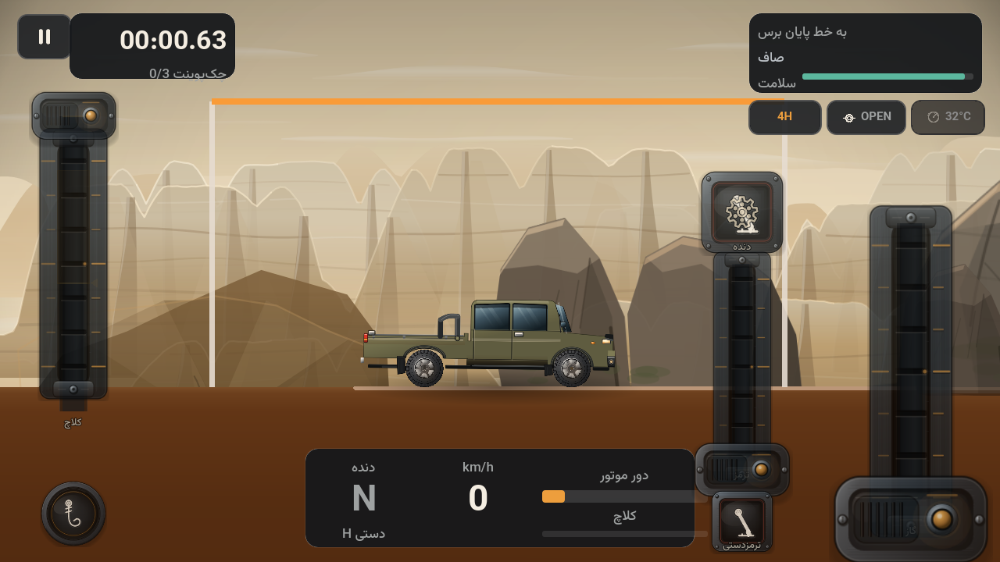
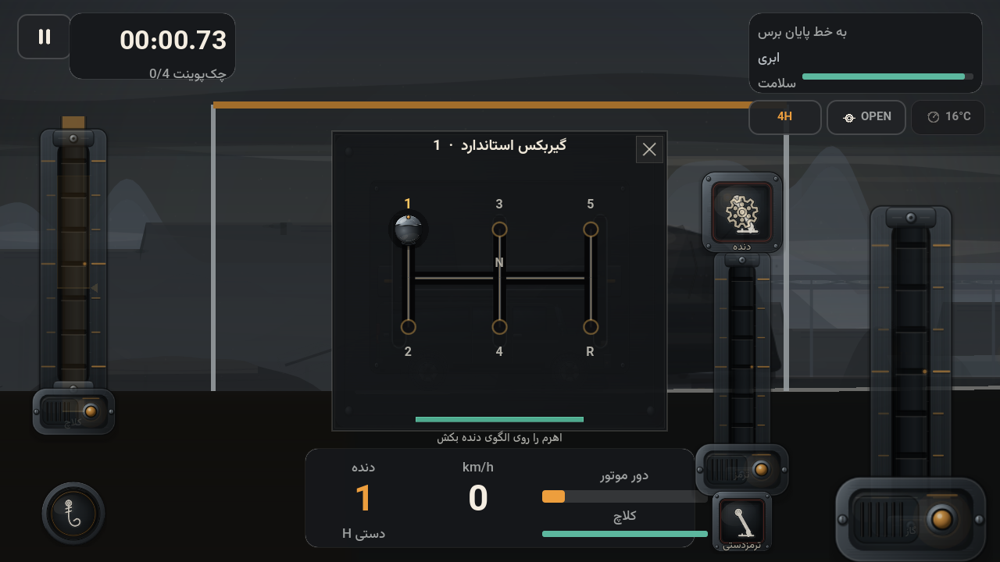
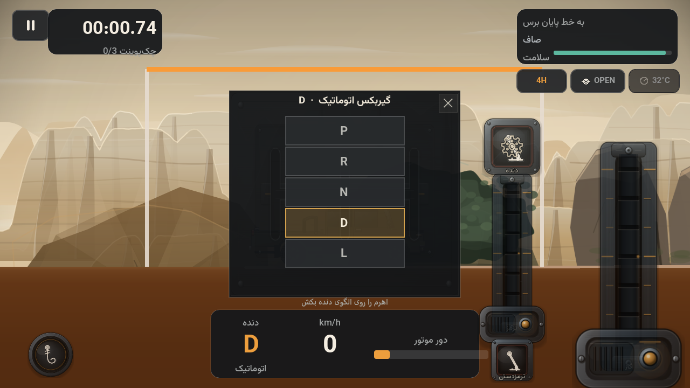
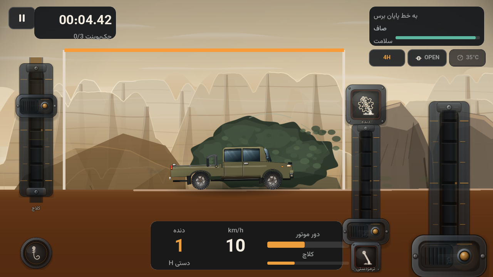
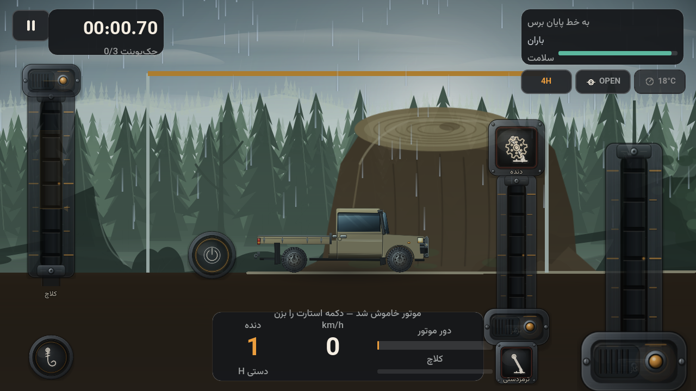

# MUDRO 3.1 — REAL DRIVER: CLUTCH, TRANSMISSION, MOUNTAIN ROADS

A cinematic side-view off-road racing game for Android, built with **Godot 4.7.2** and
typed GDScript. MUDRO is not a sprite with a speed variable: the vehicle is a real
`RigidBody2D` with two independent axle assemblies, a torque-curve engine derived from the
parts you fit, a per-vehicle gearbox, a friction clutch with a bite point, slip-based
tyres, a cooling system that can overheat on a long climb, and data-driven mountain roads.

**3.0 rebuilt the game around mountain racing.** The obstacle courses are gone — there is
no rock, log, tyre stack, barrier or broken bridge with its own collider anywhere on a
track. A race is now won by knowing the road, choosing the right car, tuning it and driving
it well.

**3.1 rebuilt the part where you actually drive it.** The manual gearbox is no longer a
selector that happens to exist: the clutch is an analog pedal with a per-car bite point and
engagement window, a shift is refused unless the pedal is on the floor, and a bad launch
stalls a real engine that has to be restarted. The default layout is now clutch on the left,
a large accelerator and a smaller brake on the right, and the H-pattern lever is its own
panel that works under a second finger.



---

## What is in the game

| | |
|---|---|
| **Vehicles** | 5 real vehicles with documented data: Suzuki Jimny JB74 1.5, Toyota Hilux AN120 2.8 GD-6, Nissan Patrol Y61 3.0 Di, Mitsubishi Pajero 3.2 DiD, Toyota Land Cruiser 79 4.2 D |
| **Regions** | 5 art regions — Zagros Highlands, Alpine Pass, Pine Valley, Black Ridge, Glacier Road — with 15 authored tracks |
| **Tracks** | Continuous elevation profiles (C1-continuous slope at every joint), authored surface sections, checkpoints, medal times and measured route stats: length, ascent, descent, max/average grade, steepest 20 m, surface mix |
| **Modes** | Mountain Rally, Hill Climb, Downhill Control, Mountain Sprint, Time Attack, Endurance, Free Drive, Vehicle Testing |
| **Transmissions** | H-pattern manual with a clutch interlock and a real bite point, sequential dog box, automatic with kickdown and a torque converter, transfer case 2H/4H/4L (Pajero adds 4HLc/4LLc), open/LSD/locked differential |
| **Workshop** | 566 parts across 30 slots: engine internals, turbo, intercooler, fuel system, cooling, ECU, gearbox, clutch, transfer case, suspension, brakes, tyres, body, drivetrain |
| **Engine model** | Boost, charge temperature and volumetric flow produce torque; the fuel system caps power; the rev limit is the lowest limit any fitted part can survive; the cooling system rejects heat or lets the engine derate |
| **Dyno** | Torque and power curves swept from the same `EngineBuild` the physics uses — no invented numbers |
| **Controls** | **3.1 default: clutch alone on the left, large accelerator and smaller brake on the right.** Three presets plus the driver layout, true multi-touch with per-finger ownership, drag-to-place layout editor, left/right hand, safe-area aware |
| **Driver modes** | Realistic manual (pedal interlock, stall, restart), assisted manual (automatic clutch, no stall), full automatic (converter, PRNDL, kickdown, uphill hold, downhill gear choice) |
| **Clutch** | Analog pedal, per-car bite point, engagement window, clamp rate, slip heat, fade limit and wear; the rail paints the fitted window |
| **Presentation** | Hand-authored SVG art, quality-scaled parallax, surface-driven particles, project-synthesised audio, physical weather, Persian-first RTL UI with an English option |
| **Radio** | Optional offline garage radio: a built-in project-made station plus sideloaded content packs validated against [`docs/RADIO_CONTENT_POLICY.md`](docs/RADIO_CONTENT_POLICY.md) |
| **Platform** | Android, landscape, offline, arm64-v8a, 36.0 MB debug APK |
| **Saves** | Versioned schema (v5) with a tested migration from the 2.0 profile — credits, owned vehicles, records, purchased parts and per-vehicle tuning all survive |

## Screenshots

Forty-one real captures of the running game, with an index and an honest list of gaps:
[`docs/screenshots/next-major-update/INDEX.md`](docs/screenshots/next-major-update/INDEX.md).

| | |
|---|---|
|  |  |
| H-pattern lever latched in first, panel separate from the pedals | The same car converted to the automatic: PRNDL, and no clutch anywhere |
|  |  |
| A real launch: first gear, 8 km/h, plates home | A dumped clutch at idle: engine dead, starter offered |

More: [route briefing](docs/screenshots/next-major-update/32_route_briefing.png) ·
[garage](docs/screenshots/next-major-update/03_garage_hilux.png) ·
[engine lab](docs/screenshots/next-major-update/45_engine_lab.png) ·
[suspension lab](docs/screenshots/next-major-update/46_suspension_lab.png) ·
[tyre shop](docs/screenshots/next-major-update/05_tyre_shop.png) ·
[dyno](docs/screenshots/next-major-update/06_dyno.png) ·
[uphill](docs/screenshots/next-major-update/22_uphill_climb.png) ·
[snow](docs/screenshots/next-major-update/25_snow_road.png) ·
[results](docs/screenshots/next-major-update/60_race_results.png)

## What 3.1 changed, in one page

| Area | Before | Now |
|---|---|---|
| Clutch | One pedal law and one bite point for every car; the rail drew a constant band | Per car: bite point, engagement window (0.38 organic / 0.28 heavy-duty / 0.22 twin plate), clamp rate, slip heat capacity, fade limit, wear rate |
| Shift gate | A shift could be forced from the keyboard, and reverse skipped the pedal test entirely | Every gear including R needs `clutch >= 0.98`; the gate is drawn from the gearbox definition (1 3 5 / 2 4 R) |
| Stall | Geometric side effect; every manual car stalled in neutral on the start line | Only when a clutch is actually loading a running engine: dumping at idle, too tall a gear, a heavy car on a climb. Restart needs the pedal or neutral |
| Assist | Manual pedal with a shift bypass that could still stall | A real automatic clutch with a manual override; no stall |
| Automatic | A conversion part that still demanded a clutch, crept off the line, had no uphill hold or downhill choice | No pedal, no stall, converter, kickdown, uphill hold, descent gear selection, PRNDL including L, pawl gated by speed |
| Layout | Throttle and brake on opposite sides, no left-hand clutch column | Clutch left; 168×432 accelerator and 104×300 brake on the right; lever and parking brake above the brake; every position checked against the HUD |
| Transmission picker | The route briefing wrote a key the build never read | The pick is honoured unless a non-stock gearbox part is fitted |

Details, evidence and the defect list: [`docs/MUDRO_3_1_BASELINE_AUDIT.md`](docs/MUDRO_3_1_BASELINE_AUDIT.md).

## How a race works

1. **Choose a region and a track.** The selection screen shows the elevation profile, the
   surface mix, your best time and whether the track is unlocked.
2. **Read the briefing.** Length, ascent, descent, maximum and average grade, the steepest
   20 m, the surface distribution, and a setup recommendation derived from those numbers.
3. **Pick the car and the setup.** Vehicle, gearbox, transfer range, differential and tyres
   are all chosen here and written to the save, so what the briefing shows is what you drive.
4. **Drive.** Checkpoints, split targets against the reference pace, a ghost of your best
   run, and a live HUD with gear, rpm, speed, damage and coolant temperature.
5. **Get paid.** Medal times, credits, XP, a new-record flag, per-vehicle records.

## Tuning: how the parts connect to the physics

Every part writes a real parameter into one model:

```
density  = (1 + boost / 1.013) * 298.15 / (273.15 + charge_temp)
torque   = k * displacement * density * volumetric_efficiency * fuel_map
power    = torque * rpm * TAU / 60
P_fuel   = min(injector_capacity, pump_capacity)      # caps torque once exceeded
rpm_lim  = min(cam, head, crank, pistons, rods, ecu)  # the weakest part decides
```

Consequences you can feel: a bigger turbo does nothing until the injectors, pump and
intercooler can support the air; a radiator that cannot reject the heat lets the coolant
climb until the engine derates; a lift kit is required before oversized tyres fit the
arches; an under-rated gearbox is refused with a reason.

## Building

### Run the tests

```powershell
.\tools\local_build\run_tests.ps1
```

337 assertions across track quality, obstacle removal, vehicle data, parts and tuning,
thermal behaviour, the dyno, transmissions, save migration, mobile/UI contracts, radio pack
gates and weather profiles. Exit code 0 means every assertion passed.

3.1 raises that to **423**: section L closes the driver-experience regressions (automatic
conversion without a pedal, assisted launch that cannot stall, reverse interlock, parking pawl
at speed, per-car cover data, the painted bite window, lever finger ownership). Current run:
`TESTS: 423/423 passed`.

### Load every scene

```powershell
.\tools\scene_smoke.ps1
```

Instantiates all 15 scenes with the autoloads present and reports any script, resource or
runtime error. (A plain `--check-only` cannot see autoload singletons and will report false
`Content`/`GameSession` errors.)

### Build the Android APK

```powershell
.\tools\local_build\build_android_debug.ps1
```

Exports `local-builds/android/MUDRO-next-major-debug.apk`, then verifies the package id,
architectures and signature with `aapt2`/`apksigner` and writes
`local-builds/reports/ANDROID_BUILD_REPORT.md`. Requires Godot 4.7.2 with the Android
export templates and an Android SDK; set `GODOT_BIN` if Godot is not in the default
location.

### Capture the screenshots

```powershell
& $env:GODOT_BIN --path . --resolution 1280x720 res://tools/capture_v31.tscn
```

Not `--headless`: the harness saves what the renderer produced. It snapshots and restores
the player's own profile.

## Technical architecture

Godot 4.7.2, typed GDScript, side-view 2D physics at 120 Hz, 64 px per metre.

| Layer | Responsibility |
|---|---|
| `scripts/core/` | Autoloads: content database, save manager, localisation, settings, input routing, scene router, game session |
| `scripts/vehicle/` | `VehicleBody` (runtime car), engine/gearbox/clutch/thermal state, wheel axles, damage, visual assembly |
| `scripts/parts/` | Part definition, catalogue, compatibility rules, `EngineBuild` derivation |
| `scripts/tracks/`, `scripts/terrain/` | Track definition and profile, track catalogue, terrain builder (road collision, surface paint, scenery) |
| `scripts/race/` | Race scene, ghost replay, weather, effects, winch |
| `scripts/garage/` | Garage model (build, sanitise, install), dyno model |
| `scripts/input/`, `scripts/ui/` | Touch controls and every screen |
| `scripts/radio/` | Content-pack loader and radio model |

Detailed references: [`docs/ARCHITECTURE_3.0.md`](docs/ARCHITECTURE_3.0.md),
[`docs/MOUNTAIN_TRACK_DESIGN.md`](docs/MOUNTAIN_TRACK_DESIGN.md),
[`docs/TUNING_SYSTEM.md`](docs/TUNING_SYSTEM.md),
[`docs/ENGINE_THERMAL_SYSTEM.md`](docs/ENGINE_THERMAL_SYSTEM.md),
[`docs/TRANSMISSION_3.0.md`](docs/TRANSMISSION_3.0.md),
[`docs/VEHICLE_DATABASE.md`](docs/VEHICLE_DATABASE.md).

## Assets and licences

All art and audio shipped in the APK is made inside this project: hand-authored SVG for
vehicles and environments, and audio synthesised from oscillators and noise by
`tools/artgen/radio_audio.py` and the existing audio generator. The register is
[`docs/ASSET_LICENSES.md`](docs/ASSET_LICENSES.md) with a machine-readable companion
[`docs/ASSET_LICENSES.csv`](docs/ASSET_LICENSES.csv); the model pipeline is described in
[`docs/ASSET_PIPELINE.md`](docs/ASSET_PIPELINE.md).

**Vehicle names and specifications.** Vehicle data comes from published manufacturer
figures, recorded per number in [`docs/VEHICLE_SPEC_SOURCES.md`](docs/VEHICLE_SPEC_SOURCES.md).
MUDRO is not affiliated with, endorsed by or sponsored by any manufacturer; marques appear
only to identify the vehicle being simulated. Any figure that could not be sourced is marked
as an estimate in that document rather than presented as factory data.

## Known limitations

Stated plainly, because a limitation list that flatters the build is worthless:

* **No Android hardware test in this pass.** The APK builds, signs and verifies, and every
  scene runs on desktop at 1280×720. It was **not** installed on a Galaxy A23 during this
  work, so the 60 FPS target on that device is a design goal, not a measurement, and the
  three-finger clutch/lever/throttle interaction is proven by touch indices in the suite,
  not by a phone.
* **The vehicles are stylised 2D art, not licensed 3D models.** No real 3D model with a
  commercial licence was found that was also safe to redistribute, so the cars are
  original drawings matched to each vehicle's real proportions, wheelbase and mechanical
  data. They are not photorealistic and do not pretend to be renders of real bodies.
* **No AI rivals yet.** Racing is against the clock and your own ghost. An opponent that
  teleports or holds a fake constant speed would be worse than none, and a physically
  honest one is not in this build.
* **Persian meme/radio content is not shipped.** The radio framework, pack format and
  validation exist and are tested; the packs themselves must be supplied with documented
  rights. The APK carries only project-made audio.
* **Dyno before/after is a two-pull flow**, not a single side-by-side screen.
* **Some part parameters are coarser than others.** Compression ratio and throttle-response
  values are read but their effect on the final torque curve is small; rods, pistons, cam,
  head, turbo, intercooler, injectors, pump, radiator, fan, ECU and gearbox all change
  measured output.
* **English UI is complete but only the Persian layout is documented in the screenshots.**

## Credits

Built with Godot 4.7.2. Vazirmatn font by Saber Rastikerdar (SIL Open Font License).
All vehicle, environment and interface art authored for this project; see
[`docs/ASSET_LICENSES.md`](docs/ASSET_LICENSES.md) and the in-game Credits screen.
