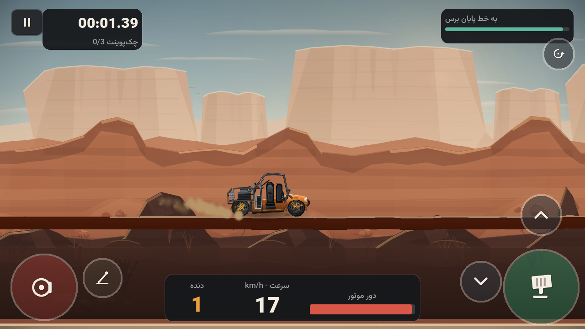

# MUDRO — OFFROAD PHYSICS 2.0

A cinematic side-view off-road driving game for Android, built with **Godot 4.7.2**
and typed GDScript. MUDRO is not a sprite with a speed variable: the vehicle is a
real `RigidBody2D` with two independent axle assemblies, a torque-curve engine, a
per-vehicle gearbox, a friction clutch, slip-based tyres and data-driven terrain.

**2.0 — THE DRIVER EXPERIENCE & VISUAL OVERHAUL** rebuilt the mobile controls,
made the transmission part of each vehicle, added a fourth region and four new
stages, and gave the game physical weather and a working winch.



## What is in the game

| | |
|---|---|
| **Vehicles** | 4 mechanically distinct machines, each with its own gearbox family: Rocky Buggy, Ranger 4x4, Dune Pickup, Titan Offroad |
| **Transmissions** | H-pattern manual with a 98 % clutch interlock, sequential dog box, automatic with kickdown + torque converter, transfer case 2H/4H/4L, open/LSD/locked differential |
| **Environments** | 4: Dry Canyon, Pine Highlands, Alpine Quarry, Black Ridge — each with its own layered art and physics profiles |
| **Stages** | 16 hand-authored stages (4 per region) with unique elevation, surfaces, obstacles, checkpoints and medal times |
| **Controls** | 3 real presets (Buttons, Analog Slider, Analog Pedals), true multi-touch, per-finger ownership, drag-to-place layout editor, left/right hand |
| **Systems** | Clutch assist or full manual, engine stall/restart, AWD/RWD, physical winch, damage, upgrades, garage configuration, route briefing, save profile, medals, credits |
| **Presentation** | Hand-authored SVG art, quality-scaled parallax, surface-driven particles, procedural audio, physical weather, Persian-first RTL UI with an English option |
| **Platform** | Android, landscape, offline, arm64-v8a, 34.3 MB debug APK |

## Controls

**Touch** — choose a preset in Settings → Controls:

* **Buttons** — throttle, brake, clutch, handbrake, gear, recover, winch, starter.
* **Slider** — vertical analog throttle and brake rails, clutch rail; travel is the value.
* **Pedals** — wide analog accelerator and brake plates, narrower clutch plate.

The gear control opens a mechanical gate: in an H-pattern car the lever must pass
through neutral, and a gear will not engage below 98 % clutch travel unless clutch
assist is on. Layout (position, size, opacity, side, margins, sensitivity,
visibility) is editable in the same screen or from the pause menu.

**Keyboard (desktop testing)** — `W`/`↑` throttle, `S`/`↓` brake, `E`/`PageUp`
upshift, `Q`/`PageDown` downshift, `Shift` clutch, `Space` handbrake, `T` transfer
case, `G` differential, `L` winch, `R` recover, `I` start engine, `Esc`/`P` pause,
`F3` physics overlay.

## Running it

```powershell
# Editor
& "$env:USERPROFILE\Godot\Godot_v4.7.2-stable_win64.exe" --path .

# Headless test suite (157 assertions)
.\tools\local_build\run_tests.ps1

# Android debug APK
.\tools\local_build\build_android_debug.ps1
```

The build scripts resolve the engine, verify its version, import the project when
the class cache is stale, and write logs under `local-builds/`.

## Project layout

```text
project.godot            Godot 4.7.2 project (GL Compatibility, 120 Hz physics, 64 px = 1 m)
scenes/                  boot, menus, route briefing, garage, vehicle config, race
scripts/
  core/                  units, locale, settings, save profile, content database, input state, router
  input/                 touch layer, button/slider/pedal widgets, gear gate panel
  vehicle/               configs (Resource), transmission profile, engine, gearbox, clutch, wheel, body, visual
  stages/                stage definitions, catalog, terrain builder (bridges included)
  race/                  race scene, backdrop, effects, weather, winch
  ui/                    UI kit, screens, HUD, layout editor, debug overlay
assets/                  SVG art (vehicles, environments, controls), fonts, synthesised WAV audio
tests/                   headless suite with real physics and race integration
tools/                   SVG validator, audio synthesisers, art generators, diagnostics, build scripts
docs/                    architecture, physics, controls, transmission, baseline audit, 2.0 notes
```

## Verification

* **157 automated assertions pass** (`tests/test_runner.tscn`): the original 68
  physics/progression checks plus input contract, per-vehicle transmissions,
  H-pattern gate, clutch interlock, automatic kickdown, transfer case,
  differential coupling, weather, winch, control layout at four aspect ratios,
  two-finger ownership, route stats, a physical bridge crossing, a real race-scene
  integration test, configuration persistence and v3 → v4 migration.
* The APK was **built locally** and its package, architecture and signature were
  verified. It was **not** installed on the Galaxy A23 in this session (no device
  was connected); that final device pass is left to the player.
* Desktop screenshots from 2.0 are in `local-builds/screenshots-v2/`.

See `docs/PHYSICS.md` for the equations, `docs/CONTROLS.md` for the touch
architecture, `docs/TRANSMISSION.md` for the gearbox model, `docs/MUDRO_2.0.md`
for the delivery status and known limitations, and `docs/ASSET_LICENSES.md` for
licensing.

---

## خلاصهٔ فارسی

**مادرو ۲.۰** یک بازی آفرود دو‌بعدی سینمایی برای اندروید است که با گودو ۴.۷.۲ ساخته
شده. فیزیک خودرو واقعی است: شاسی `RigidBody2D`، دو محور مستقل با تعلیق فنر-دمپر،
موتور با منحنی گشتاور، گیربکس اختصاصی هر خودرو، کلاچ اصطکاکی و تایر با منحنی لغزش.

در ۲.۰ کنترل موبایل از پایه بازنویسی شد: یک لایهٔ ورودی مشترک، سه پریست واقعی
(دکمه‌ای، اسلایدر آنالوگ، پدال آنالوگ)، چندانگشتی واقعی با مالکیت مستقل هر انگشت،
و ویرایشگر چیدمان. هر خودرو گیربکس خودش را دارد: H-pattern با شرط کلاچ ۹۸٪،
ترتیبی، و اتوماتیک با کیک‌داون؛ به‌همراه جعبهٔ انتقال 2H/4H/4L و دیفرانسیل
باز/لغزش محدود/قفل.

منطقهٔ چهارم «یال سیاه» با چهار مرحلهٔ جدید اضافه شد (مجموع ۱۶ مرحله)، همراه با
پل فولادی قابل رانندگی، آب‌وهوای فیزیکی، وینچ واقعی، گرافیک و صدای ارتقایافته و
صفحهٔ معرفی مسیر. ۱۵۷ تست خودکار عبور می‌کنند و APK محلی امضاشده ساخته شده است.
تست نهایی روی گوشی واقعی در این سشن انجام نشده و باید با APK تحویلی بررسی شود.
